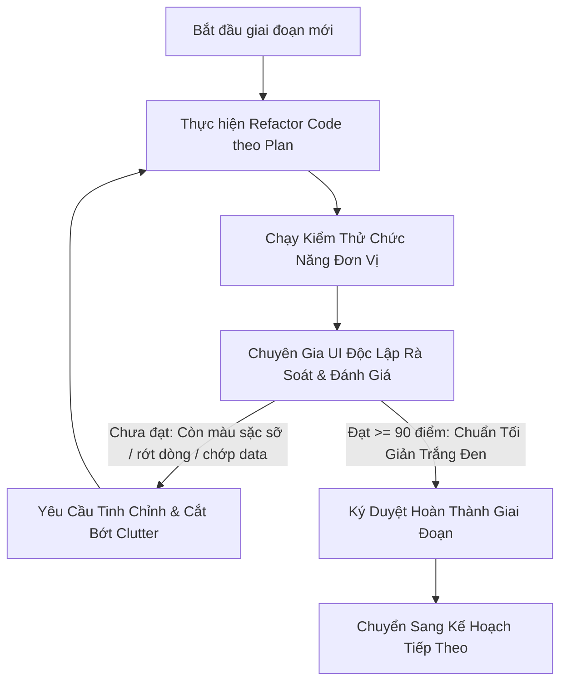

# KẾ HOẠCH TỔNG THỂ & QUY TRÌNH KIỂM SOÁT CHẤT LƯỢNG UI (UI EXPERT GATEKEEPER)
**Hệ thống:** Austec IoT Platform (Web Admin & Flutter Mobile App)  
**Thư mục lưu trữ:** `d:\Work\Austec\plans`  
**Ngày lập kế hoạch:** 03/11/2026  
**Mục tiêu cốt lõi:** Chuẩn hóa toàn bộ trải nghiệm người dùng, loại bỏ triệt để giao diện "AI sặc sỡ / màu mè / rối mắt", chuyển đổi sang phong cách **Tối giản - Trắng đen (Monochrome Industrial Minimalist)**, xóa bỏ 100% Mock Data & Flicker giật màn hình, hoàn thiện tính năng tương tác chuyên nghiệp.

---

## 1. BỐI CẢNH VÀ NGUYÊN TẮC CẢI TIẾN TRỌNG TÂM

Qua rà soát thực tế hệ thống Web-Admin và Mobile App hiện tại, tồn tại các vấn đề nghiêm trọng ảnh hưởng đến chất lượng sản phẩm:
1. **Lạm dụng màu sắc & hiệu ứng AI:** Quá nhiều viền neon (xanh ngọc, tím, vàng chói), nền đổi màu gradient, bóng đổ nhòe (backdrop-blur) quá đà khiến giao diện rối rắm, thiếu tính chuyên nghiệp của một nền tảng thiết bị công nghiệp/nhà thông minh.
2. **Hiện tượng giật dữ liệu (Data Flicker & Mockdata):** 
   - Khi vào trang (như `/dashboard`), hiển thị số liệu mẫu cũ (7 thiết bị, 6 online...) rồi mới nhảy sang số liệu thực tế.
   - Khi vào `/devices?tab=list`, danh sách chớp hiện thông báo trống "Chưa có thiết bị nào trong CSDL PostgreSQL..." rồi mới nạp danh sách thực tế.
   - Thiếu vòng xoay loading đồng bộ trên từng khối/bảng.
3. **Thừa thãi mô tả & điều hướng kép (Web Admin):** 
   - Thanh điều hướng ngang phụ ở trang Quản lý thiết bị lặp lại hoàn toàn Menu Sidebar bên trái.
   - Các dòng mô tả dài dòng ("Danh mục nhóm sản phẩm & dải thiết bị phần cứng trong hệ sinh thái") chiếm diện tích vô ích.
   - Trang `/devices/pairing-lab` không còn phù hợp cần loại bỏ hoàn toàn mã nguồn.
4. **Vấn đề bố cục & hiển thị (Mobile App):**
   - Khối chào mừng, thông tin thời tiết, nút sáng/tối bị đè trực tiếp lên ảnh banner quảng bá gây rối mắt, khó đọc.
   - Nút bấm điều khiển thiết bị bị to quá khổ, chữ bị rớt dòng cụt lủn (ví dụ: "Khóa an / toàn").
   - Nút CSKH cố định chiếm không gian, thiếu khả năng kéo di chuyển hoặc vuốt xuống để đóng.
   - Thiếu màn hình chờ (Splash Screen) chuyên nghiệp với hiệu ứng Radar quét kết hợp nhận diện thương hiệu Austec.

---

## 2. CHUYÊN GIA UI ĐÁNH GIÁ (UI EXPERT EVALUATION FRAMEWORK)

Để đảm bảo các giai đoạn triển khai không bị đi lệch định hướng hoặc tái diễn phong cách AI rườm rà, kế hoạch thiết lập cơ chế **Hội đồng Thẩm định UI Expert**. 

### 2.1. Bộ tiêu chuẩn 8 KHÔNG của Chuyên gia UI (The 8 "NO" Principles)
* **KHÔNG viền Neon phát sáng:** Loại bỏ toàn bộ `border-cyan-500 shadow-[0_0_15px_rgba(...)]`, chuyển về viền đơn sắc tinh tế (`border-slate-200 dark:border-slate-800`).
* **KHÔNG gradient chuyển màu sặc sỡ:** Nền card chỉ dùng màu phẳng trung tính (`bg-white dark:bg-zinc-900/95`).
* **KHÔNG lạm dụng Icon:** Mỗi card/hàng bảng chỉ giữ icon khi thực sự có giá trị chức năng nhận diện. Bỏ icon trang trí thừa.
* **KHÔNG chữ rớt dòng cụt (No Orphan Words):** Tuyệt đối không để text trên nút bấm hoặc nhãn bị gãy chữ vô duyên trên màn hình nhỏ.
* **KHÔNG mô tả giải thích dài dòng:** Loại bỏ toàn bộ subtitle mang tính văn vở; chỉ để lại tiêu đề và dữ liệu tương tác.
* **KHÔNG thuật ngữ cơ sở dữ liệu nội bộ:** Cấm hiển thị các từ ngữ như "CSDL PostgreSQL", "Kafka topic", "REST payload" lên giao diện người dùng cuối.
* **KHÔNG hiển thị Mockdata trước khi nạp API:** Cấm gán giá trị khởi tạo giả lập gây hiện tượng nhảy số.
* **KHÔNG chớp thông báo rỗng khi đang gọi mạng:** Trạng thái đang tải (Loading) phải ưu tiên hiển thị trước; chỉ hiển thị rỗng sau khi API trả về mảng rỗng `[]`.

### 2.2. Ma trận Chấm điểm UI Expert (Thang điểm 100)
Mỗi Module/Trang sau khi hoàn thiện phải đạt **tối thiểu 90/100 điểm** mới được nghiệm thu:

| Tiêu chí | Trọng số | Mô tả kiểm tra |
| :--- | :---: | :--- |
| **Độ tối giản & Màu sắc** | 25% | Đúng tông màu Trắng - Đen - Ghi xám, hạn chế tối đa xanh biển, không màu chói lóa. |
| **Loading State & Data Flicker** | 25% | 100% có spinner xoay tròn khi gọi API, không chớp mockdata, không báo trống giả lập. |
| **Tỷ lệ nút & Typography** | 20% | Nút bấm vừa vặn ngón tay, kích thước font chuẩn 12-14px, không rớt dòng. |
| **Bố cục & Không gian (Whitespace)** | 15% | Tinh gọn khoảng cách, padding hợp lý, loại bỏ các mô tả và thanh tab thừa thãi. |
| **Trải nghiệm thao tác (UX)** | 15% | Đầy đủ Checkbox chọn nhiều, Xóa hàng loạt, Phóng to ảnh qua Dialog, Vuốt tắt thông báo. |

---

## 3. CẤU TRÚC BỘ TÀI LIỆU KẾ HOẠCH (PLAN BUNDLE)

Toàn bộ kế hoạch chi tiết được phân rã thành các tệp tài liệu chuyên đề tại thư mục `d:\Work\Austec\plans`:

1. [`00_MASTER_PLAN_AND_UI_EXPERT_GATEKEEPER.md`](file:///d:/Work/Austec/plans/00_MASTER_PLAN_AND_UI_EXPERT_GATEKEEPER.md):  
   Kế hoạch tổng thể, nguyên tắc kiến trúc và cơ chế thẩm định của Chuyên gia UI.
2. [`01_DESIGN_SYSTEM_AND_MONOCHROME_REVAMP.md`](file:///d:/Work/Austec/plans/01_DESIGN_SYSTEM_AND_MONOCHROME_REVAMP.md):  
   Thiết kế hệ màu Monochrome (Trắng - Đen - Xám kim loại), chuẩn hóa Typography, loại bỏ hiệu ứng neon/blur và tiêu chuẩn Icon.
3. [`02_DATA_INTEGRITY_LOADING_AND_MOCKDATA_ELIMINATION.md`](file:///d:/Work/Austec/plans/02_DATA_INTEGRITY_LOADING_AND_MOCKDATA_ELIMINATION.md):  
   Xóa bỏ 100% Mock Data, kiến trúc Loading Spinner toàn diện, triệt tiêu hiện tượng giật dữ liệu và viết lại thông báo thân thiện.
4. [`03_WEB_ADMIN_DETAILED_REVAMP.md`](file:///d:/Work/Austec/plans/03_WEB_ADMIN_DETAILED_REVAMP.md):  
   Kế hoạch chi tiết Web-Admin: Xóa bỏ Pairing Lab, bỏ khối chuyển hướng trùng lặp, bỏ mô tả thừa, thêm Dialog phóng to ảnh, Checkbox chọn nhiều & Xóa hàng loạt.
5. [`04_MOBILE_APP_DETAILED_REVAMP.md`](file:///d:/Work/Austec/plans/04_MOBILE_APP_DETAILED_REVAMP.md):  
   Kế hoạch chi tiết Flutter Mobile: Tích hợp Asset logo/banner, Splash Screen Radar quét, tách rời khối User khỏi ảnh Hero, tinh chỉnh nút bấm & kéo thả nút CSKH.
6. [`05_IMPLEMENTATION_PHASES_AND_CHECKLIST.md`](file:///d:/Work/Austec/plans/05_IMPLEMENTATION_PHASES_AND_CHECKLIST.md):  
   Phân kỳ triển khai theo 6 giai đoạn rõ ràng, kịch bản kiểm thử Acceptance Testing và Checklist ký duyệt từng mốc.

---

## 4. QUY TRÌNH DUYỆT TIẾN ĐỘ TỪNG PHẦN (GATEKEEPER WORKFLOW)

Mỗi khi hoàn thành một tệp kế hoạch, hệ thống sẽ tự động kích hoạt phiên rà soát của Chuyên gia UI theo ma trận đã ban hành. Chỉ khi Chuyên gia UI xác nhận giao diện đã thực sự **sạch sẽ, tối giản, sang trọng và không còn dấu vết của AI clutter**, giai đoạn tiếp theo mới được phép tiến hành.
